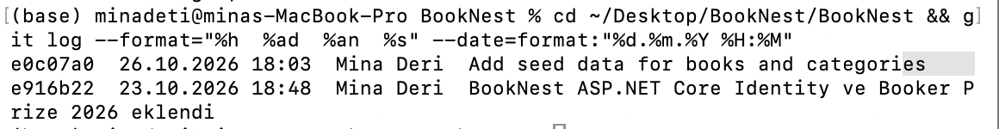

# BookNest

Goodreads benzeri bir kitap takip uygulaması. Kullanıcılar kitapları keşfedebilir, puan verebilir, okuma raflarını yönetebilir, yorum yazabilir ve diğer okurlarla etkileşime geçebilir.

**Teknolojiler:** ASP.NET Core Razor Pages (.NET 10), Entity Framework Core, SQL Server, ASP.NET Core Identity

## Özellikler

- Kullanıcı kaydı ve girişi (e-posta veya kullanıcı adıyla)
- Kitaplara 1-5 yıldız puan verme ve ortalama puan
- Okuma rafları: Want to Read, Currently Reading, Read, Did Not Finish
- Favoriler ve kişisel **My Books** sayfası
- Kitaplara yorum yazma, düzenleme ve silme
- Yorumları beğenme (Like) ve yorumlara yanıt verme
- Admin rolü ve Google Books'tan kitap ekleme
- Ekip içinde ortak kitap listesi (`Data/kitaplar.json`)
- Mobil uygulama için kitap API'si (`/api/books`)

## Ekip ve katkılar

| Kişi | Katkılar |
|---|---|
| **Mina Deri** | İlk proje iskeleti (ASP.NET Core projesi, Identity ile kullanıcı sistemi, veritabanı modelleri, Booker Prize 2026 kitapları), okuma rafları, favoriler, My Books sayfası, yorum sistemi, yorum beğenme, yorumlara yanıt, arayüzün İngilizceye çevrilmesi, macOS kurulumu |
| **Makbule Yılmaz** | Veritabanının MSSQL'e taşınması |
| **Ümmügülsüm Ayaz** | Puan sistemi, admin rolü, kullanıcı adıyla giriş, karşılama sayfası, Google Books entegrasyonu, ortak kitap listesi (kitaplar.json), kitap API'si |

## Proje geçmişi

Proje 23 Ekim 2026'da başlatıldı. 28 Ekim'deki MSSQL geçişinde depo yeniden oluşturulduğu için ilk iki commit bu deponun geçmişinde yer almıyor. Orijinal commit'ler:



## Kurulum

Proje ilk çalıştırıldığında veritabanını, admin hesabını ve kitapları otomatik olarak oluşturur.

### Windows

```
dotnet user-secrets set "AdminPassword" "<admin-sifresi>"
dotnet run
```

Varsayılan olarak SQL Server LocalDB kullanılır.

### macOS

macOS'ta LocalDB olmadığı için SQL Server Docker ile çalıştırılır (Apple Silicon'da Docker Desktop ayarlarından Rosetta açık olmalı):

```
docker run -e "ACCEPT_EULA=Y" -e "MSSQL_SA_PASSWORD=<guclu-sifre>" -p 1433:1433 --name booknest-sql --platform linux/amd64 -d mcr.microsoft.com/mssql/server:2022-latest

dotnet user-secrets set "ConnectionStrings:DefaultConnection" "Server=localhost,1433;Database=BookNestDb;User Id=sa;Password=<guclu-sifre>;TrustServerCertificate=True;MultipleActiveResultSets=true"
dotnet user-secrets set "AdminPassword" "<admin-sifresi>"
dotnet run
```

### Bilinen durum

**Add Book** sayfası Google Books API'sini kullanır. Google artık anahtarsız isteklere izin vermediği için bu sayfanın çalışması için bir API anahtarı gerekir.